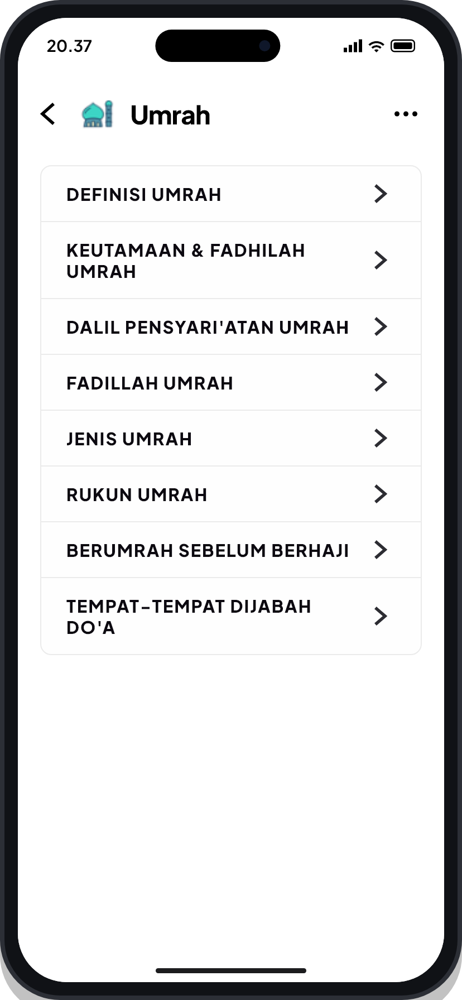
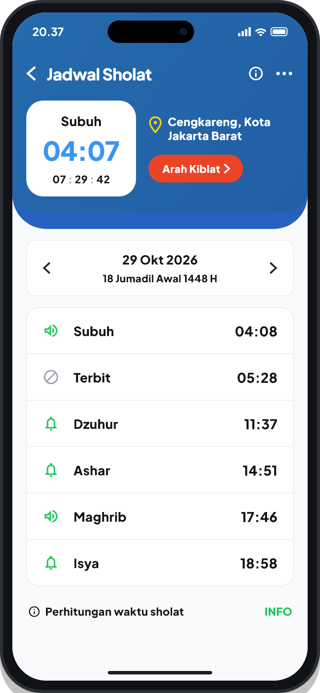
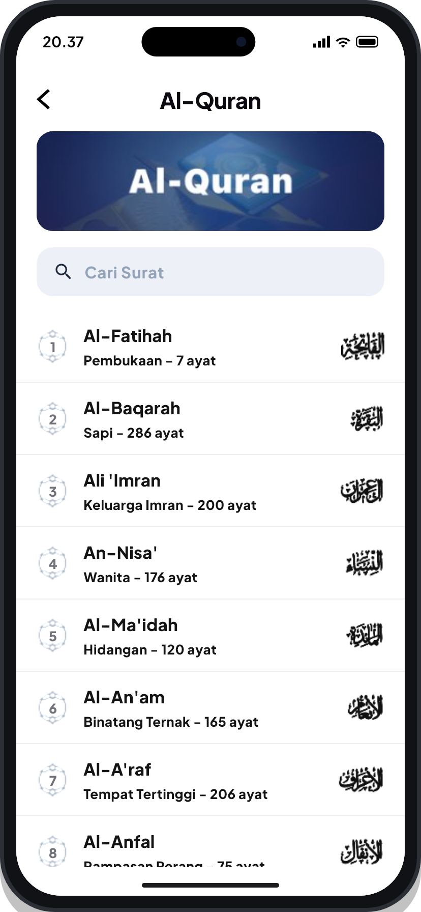
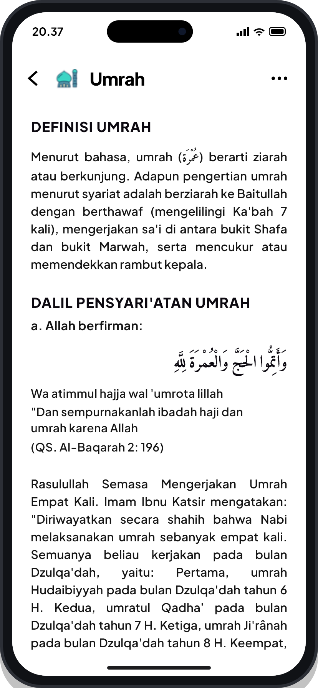
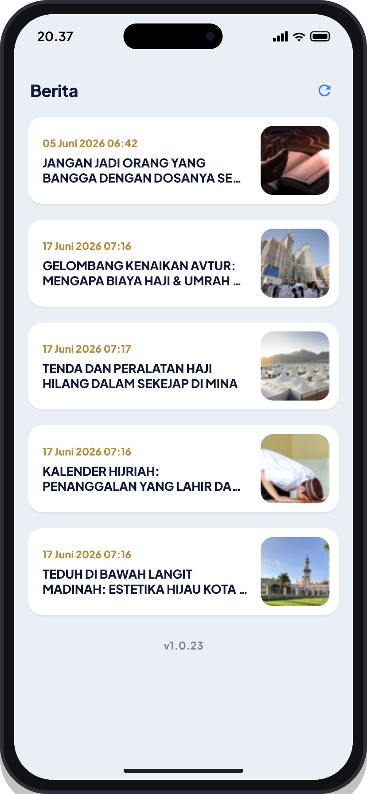
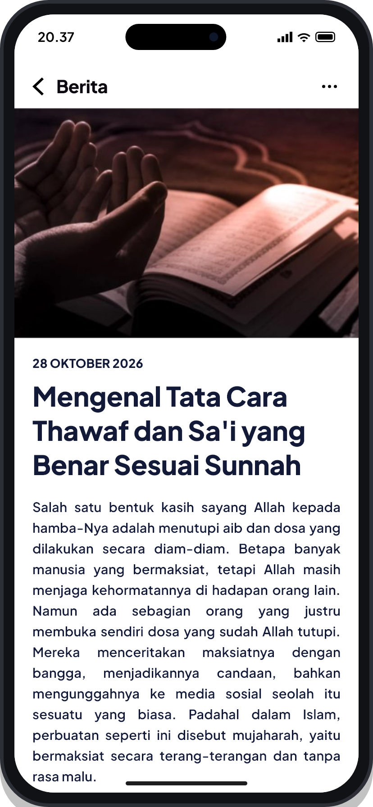

# Tanur

Koleksi slicing antarmuka yang  saya buat selama magang di PT Tanur Muthmainnah Tour.

---

## Tampilan Layar

| Menu Utama | Jadwal Sholat | Al-Qur'an |
| :---: | :---: | :---: |
|  |  |  |

| Panduan Umrah | Berita Umrah | Detail Artikel |
| :---: | :---: | :---: |
|  |  |  |

---

## Daftar Layar

- **Menu Utama**: Navigasi daftar materi dan panduan ibadah umrah.
- **Jadwal Sholat**: Informasi jadwal waktu sholat harian, hitung mundur waktu berikutnya, dan penunjuk arah kiblat.
- **Al-Qur'an**: Daftar surah dilengkapi nomor berornamen islami, informasi ayat, dan kaligrafi nama surah.
- **Panduan Umrah**: Teks materi manasik ibadah lengkap dengan dalil berharakat Arab dan terjemahan.
- **Berita Umrah**: Daftar informasi dan kabar terkini seputar tanah suci dalam format kartu berita.
- **Detail Artikel**: Halaman baca artikel lengkap dengan banner foto utama.

---

## Cara Menjalankan

1. Unduh paket dependensi:
   ```bash
   flutter pub get
   ```

2. Jalankan project:
   - **Browser (Chrome)**:
     ```bash
     flutter run -d chrome
     ```
   - **Emulator**:
     ```bash
     flutter run
     ```
